# Operations console

Talon is a self-hosted control plane for a company's AI use cases: one company policy, with cost control, reliability, shared policy and session understanding applied to every use case that runs through it, and signed, verifiable evidence as the proof layer. The operations console is the **operational view** of that control plane. It is how the people who run Talon see what the control plane is doing; it is not a separate product, and it adds no control of its own.

It is a read-only browser view of one Talon installation. It answers the questions an operator asks about the installation and the AI use cases Talon governs: whether the installation can serve governed traffic now, which use cases need attention and why, what they cost against their caps, what Talon decided for a request and what happened to it, what is configured, and how far the shown data can be trusted.

Every number on a page comes from the same Go projections the `talon` CLI prints. The browser formats and lays out; it does not compute health, budgets, decisions or sessions. When a source could not be read, or a figure is not a measurement, the page says so instead of showing a zero.

## Start it and sign in

With the default Docker Compose stack the console runs as the `talon-ui` service on `http://127.0.0.1:8787/`. Without Compose:

```bash
talon ui                     # starts the console and opens the browser
talon ui serve               # headless; prints the pairing code to stdout
```

The browser asks for a one-time pairing code. Read it from the console's own output (`docker compose logs talon-ui`, or the terminal running `talon ui`); `talon ui pair` makes the running console print a fresh one to that same output (the `pair` command itself prints no code). Keep that output out of shared logging systems. Codes are single use and expire within ten minutes. The browser then holds a read-only session cookie; no admin, agent or vault key ever reaches it. When the session ends (expiry, logout, console restart), the page asks for a new code and returns to where you were. Details and the threat model: [console access](../reference/console-access.md).

## The pages

| Page | Question it answers | Source |
|---|---|---|
| **Overview** | What needs attention across the installation and the selected tenant, and why? | operational readiness (runtime records, configuration digests, agent keys the processes report, store reads), findings, the `talon agents` fleet projection, today's counters, request-class activity buckets, recent operational events |
| **AI Use Cases** | What AI use cases do we operate, how are they doing, how are they governed? | the same fleet rows, unchanged order, each with its **Status**: the status `talon agents show <name>` leads with ([read contract §2.9](../reference/console-read-contract.md#29-use-case-status-575)); each use case's page has four sections: **Summary** (is it operating as expected? led by the same *Status* and *Next step* `talon agents show` prints, with the one-line *Connection and verification* reading: loaded or not, authenticated traffic observed or not, under which policy), **Sessions & Activity** (what happened when it ran?), **Policy & Runtime** (what is permitted, and which policy is active?), **Costs** (what does it cost?) |
| **Approvals** | Which Action Gateway requests wait for a person, why do they need approval, and what was decided? | the action tables of the store, read-only; the same projection as `talon approvals` without argument values ([read contract §2.8](../reference/console-read-contract.md#28-approvals-565)) |
| **Sessions** | What happened in this session, what did Talon decide, and was anything sent? | session store rows and evidence-observed session ids, summary and timeline from `talon session show` |
| **Costs** | How much, where, and are budgets respected? | `talon costs --json` (`costs.Build`) |
| **Configuration** | What is configured, and what can be proven active? | the gateway and agent files, summarised server-side |
| **System** | Are Talon's runtimes operating, can I trust the sources behind this console, and what did the installation itself record? | operational readiness, each process's runtime record, the console process, the evidence store file, and **Installation activity**: Talon's own installation events (configuration reloads activated or rejected, recovery resumed after a restore), each with its time, outcome, the Talon process that recorded it and a link to its signed record |

Evidence records open from any timeline, event or search result (`/evidence/<id>`).

## Where the console fits when you adopt Talon

The console does not connect, configure or change anything; the CLI and the configuration files do. It is where you look at each step of bringing AI use cases under one company policy:

| Step | You do it with | The console shows |
|---|---|---|
| 1. Connect an existing AI use case | an agent file and its key; the application points at Talon instead of the provider or the MCP server ([quickstart](../QUICKSTART.md)) | **AI Use Cases**: the use case appears with its tenant and owner; its status moves from *Not active* to *Waiting for its first request* once a running Talon process serves it, and to *Working* after its first authenticated request under the current policy |
| 2. Establish company policy and the use case's own restrictions | `talon.config.yaml` (organization baseline and hard constraints), the agent file (including its MCP action sources and action definitions) | **Configuration**: what the files say; each use case's **Policy & Runtime**: the effective policy and which layer set each rule |
| 3. Operate the use case | nothing: traffic flows through Talon | **Overview**, the use case's **Summary**, **Costs** against its caps, **Sessions** |
| 4. Check readiness, effective policy and activation | `talon serve`; `talon agents show <name> --effective` | **Overview** and **System**: which runtimes run and which keys they hold; *Proven active* only where a running process reports having loaded the current files |
| 5. Change a supported policy and see the result | edit the file; wait for the reload or restart the process, as that file requires | the effective policy and its activation state change; later decisions carry the new policy; the evidence of earlier decisions stays as recorded |
| 6. Connect further AI use cases under the same company policy | another agent file and key; the organization baseline and constraints already apply | another row in **AI Use Cases**, governed by the same baseline, with its own budget, sessions and evidence |
| 7. Investigate and verify a decision when needed | `talon audit show`, `talon audit verify` | use case → session → decision → signed evidence, with the signature check |

**Activation differs per file; the console reports it rather than assuming it.** Agent file contents and `agents_dir` membership are re-scanned by a running `talon serve` (`agents_reload_interval`, default 30s) and a valid change activates as one generation; a rejected reload keeps the previous generation active and is shown on System. The `gateway:` block of `talon.config.yaml` (organization policy, providers), pricing and key rotation are restart-required ([configuration reference](../reference/configuration.md)). Until a running process reports the new digests, the console shows the change as file contents that are *not proven active*.

## Walkthrough in pictures: a sensitive business function under controlled conditions

The walkthrough uses People Analytics: an HR analytics assistant that may run aggregate queries over HR data through a governed MCP tool (the HR backend is the use case's MCP action source, called through `POST /mcp`) and must never export employee records. It is one AI use case in a sensitive business function, introduced under explicit conditions: an allowed tool, a forbidden tool, cost caps, and evidence for every decision. The same conditions hold in the independent real-process acceptance for this scenario (`make test-people-analytics-live`): the allowed aggregate reaches the HR backend, the forbidden export never does, and the backend's own SQL rejection after dispatch is recorded as an `unknown` outcome, not as a Talon denial.

These are **real console screenshots** from the synthetic Playwright test installation, not production customer data, and not a record of a business result. The fixture deliberately introduces an undecryptable agent key and other diagnostic conditions; an offline or degraded runtime is intentional for the failure examples. The fixture holds a small set of seeded use cases; the pictures do not show several production applications sharing a policy, and no such traffic is claimed. A screenshot is a view of recorded facts, not independent proof of a downstream business effect.

### 1. See whether the installation can serve, before trusting any use-case view

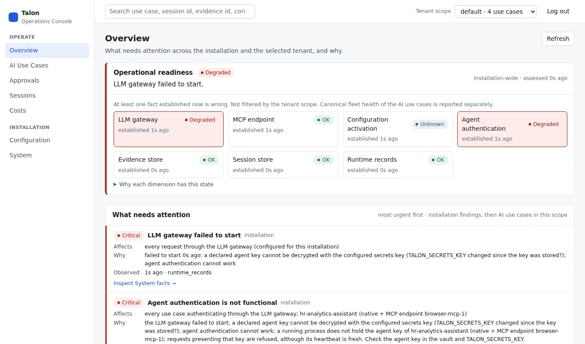

*Start at Overview: installation readiness is shown separately from the fleet-health assessment; selecting a tenant does not hide shared runtime failures.*

### 2. Operate the use case: is it running as intended, under which policy, at what cost

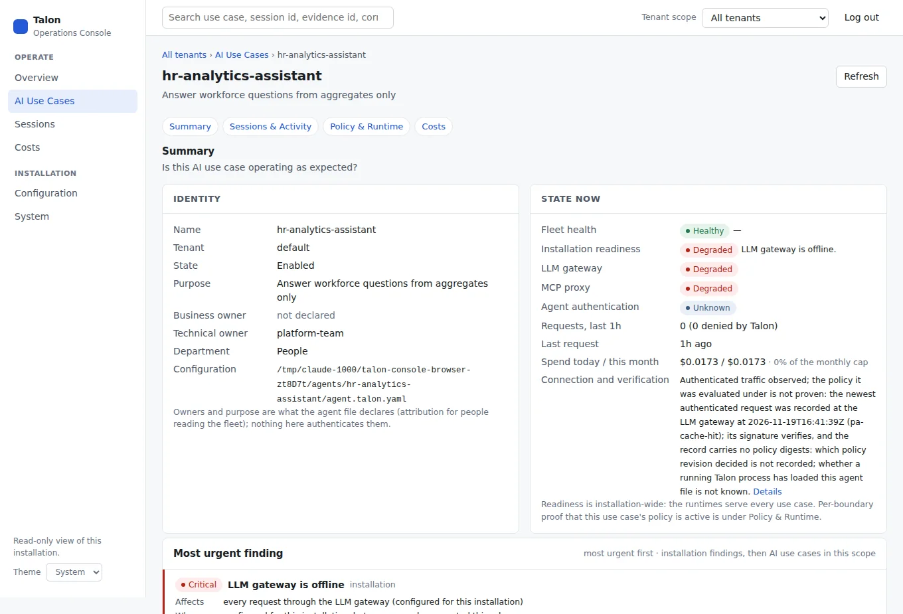

*One use case combines Summary, Sessions & Activity, Policy & Runtime, and Costs. The Summary leads with the use case's status and next step, as `talon agents show` prints them: here no Talon process runs in the fixture, and the seeded requests carry no policy digests, so it needs attention. Fleet health below judges budgets, denials and failures, not whether anything serves the use case.*

### 3. See the conditions hold in a real session

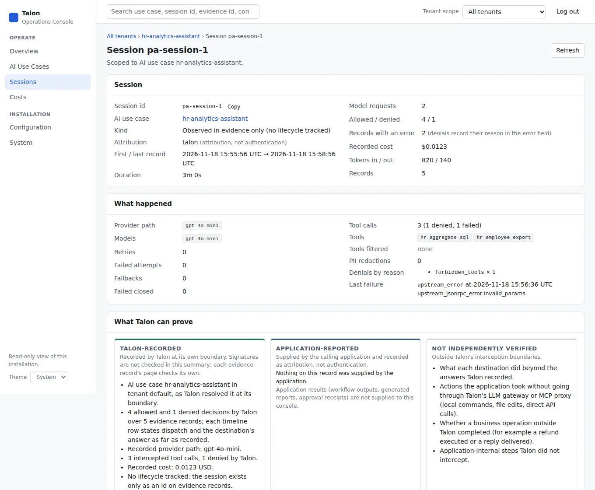

*Three different outcomes in one session: Talon allowed and dispatched an aggregate; Talon denied an employee export before dispatch, so the HR backend never received it; Talon allowed a SQL tool call that the HR backend itself rejected. The session is evidence-observed, not a lifecycle Talon invented. (The tool records shown are the shape an earlier release's MCP proxy wrote, which the console still reads; on the governed `POST /mcp`, a rejection the backend reports after dispatch reads *Outcome unknown*.)*

### 4. Verify a decision when someone asks

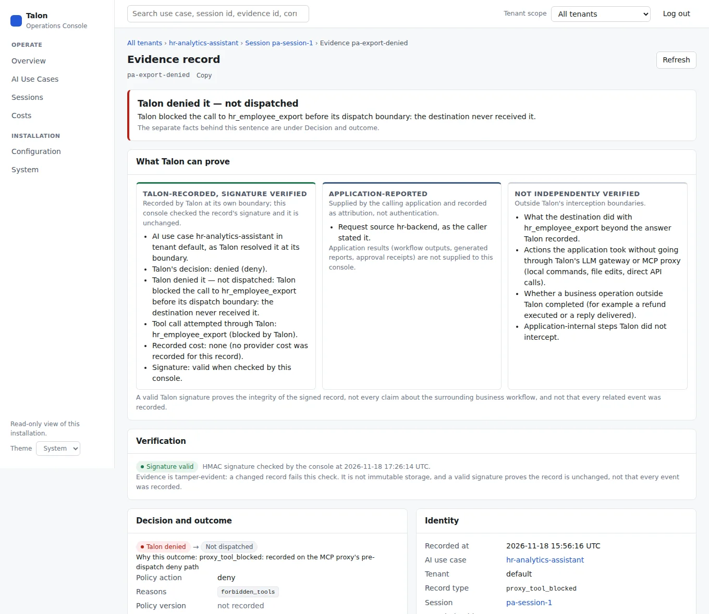

*The signature proves the stored record was not changed since signing, checked with the installation's signing key. It does not prove that no bypass route exists or that an external business outcome completed.*

### Adding the next use case

A further AI use case is another agent file and key under the same `talon.config.yaml`. It gets the organization baseline and hard constraints without restating them, its own caps and restrictions, and the same pages: no new dashboard, log pipeline or review procedure per application. The console then lists it beside the first one. What is shared is the operating layer and the company policy; each use case's traffic, budget and evidence stay its own.

### Other operator views

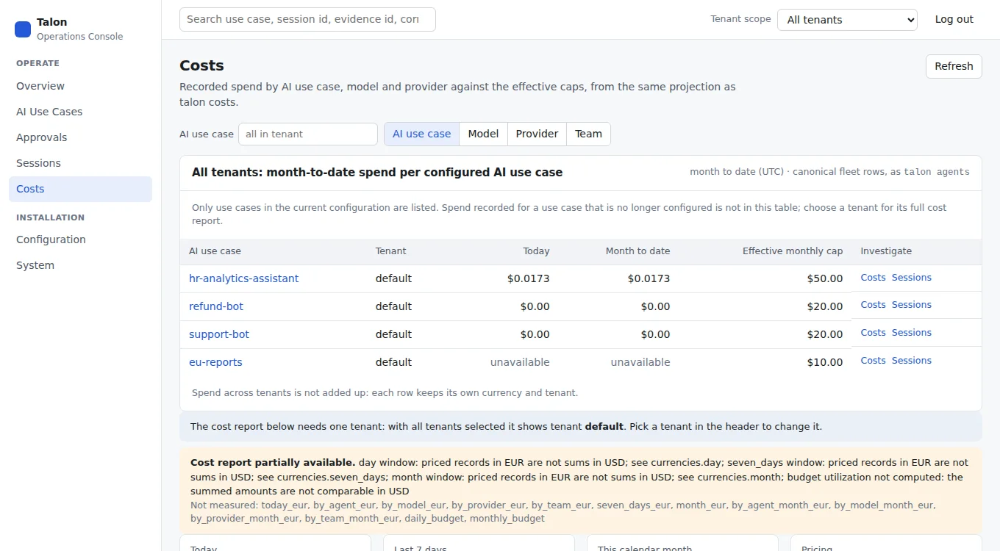

*Costs never silently sum incompatible currencies; unpriced usage and unavailable budgets remain labeled.*

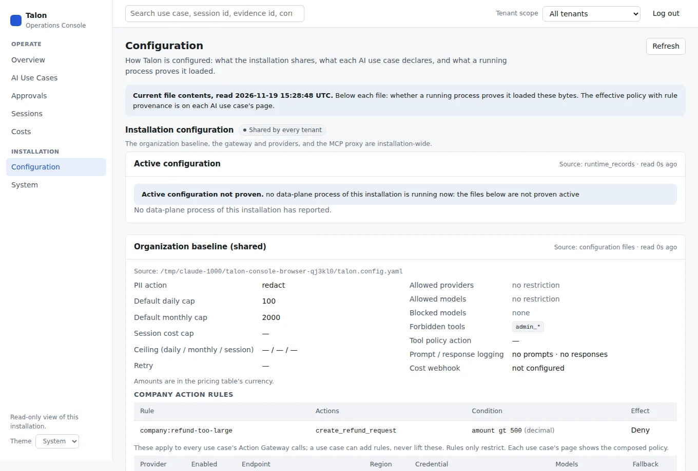

*Configuration shows current file contents; separately reported process activation proves which bytes have actually been loaded.*

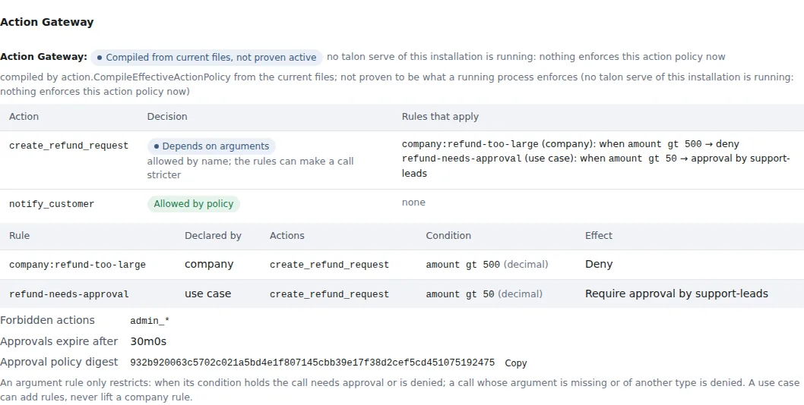

*Each use case's effective policy lists its Action Gateway actions. An action with argument rules reads "Depends on arguments", never "Allowed"; every rule names the layer that declared it. "Proven active" appears only when every running `talon serve` reports this agent file and the gateway config it read the company action policy from.*

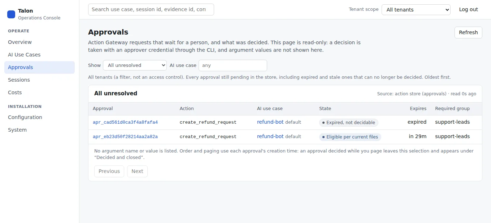

*The Approvals page lists Action Gateway requests that wait for a person. "Eligible per current files" means the configuration files still match what the request was established under; it reads "Can be decided now" only when a running `talon serve` is proven to have loaded those files. When the files were changed and no running process is proven to run them, a request reads "Files changed, runtime not confirmed" and stays listed: the process may still hold the configuration it was established under. A request whose lifetime elapsed stays unresolved in the store and reads "Expired, not decidable". No argument name or value is listed, and a reviewer's reason is never shown: the console states that one was recorded.*

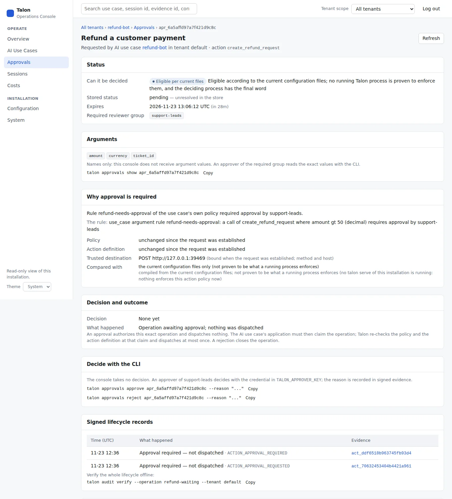

*One approval: the requesting AI use case, whether it can still be decided and on what that statement rests, the argument **names**, the rule and policy layer that required approval, the decision and what happened afterwards, and the signed lifecycle records. The console shows no argument value and has no decision control: an approver reads the exact values with `talon approvals show <approval-id>` and decides with `talon approvals approve|reject`.*

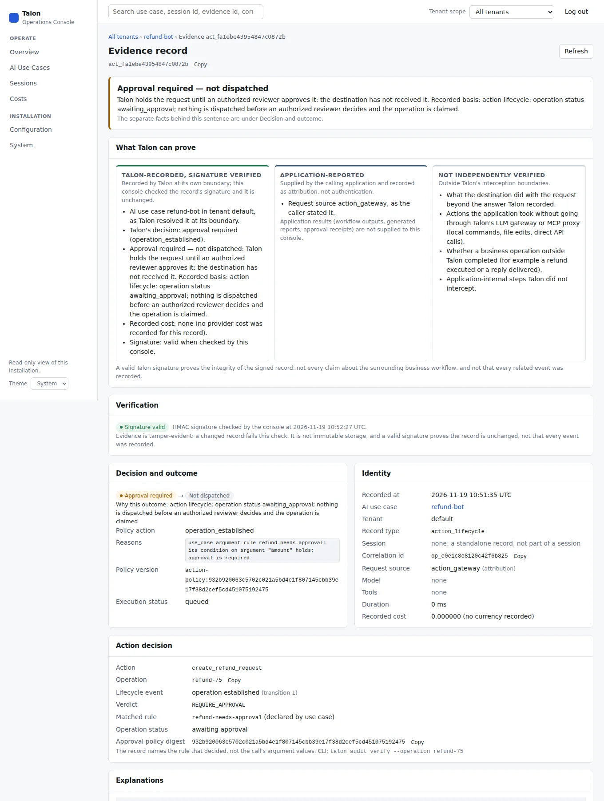

*An action lifecycle record shows the actual verdict, the matched rule and who declared it, and the operation's status. A refund waiting for a reviewer reads "Approval required — not dispatched", not "allowed". The record names the rule, never the call's argument values.*

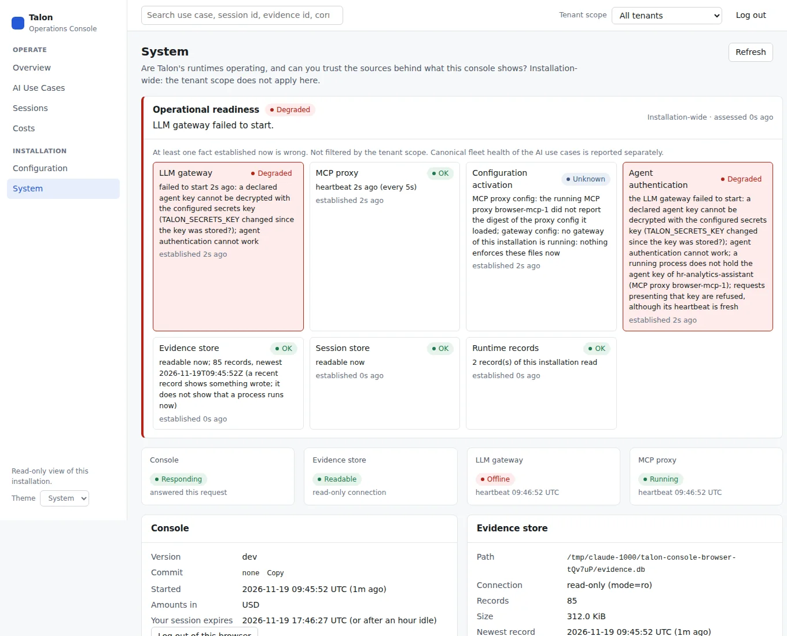

*System is the diagnostic drill-down for process state, runtime records, activation, and evidence-store access.*

For negative evidence-verification testing, see the [tampered-record example](../assets/console/tamper-detection.webp). To reproduce or recapture these images, see [screenshot provenance](../assets/console/README.md).

## Reading the pages correctly

- **Denied requests are requests, not every Talon denial.** The *Denied requests* counters (AI Use Cases, a use case's Sessions & Activity, the activity chart; the Overview's *Denied today*, marked *request-class records*) count request-class records: LLM gateway and tool requests Talon denied. A governed action decision (the Action Gateway, over HTTP or MCP) is not a request and is not in that counter; it is listed with its own outcome under the use case's *Recent decisions* and, when it waits for a person, under *Approvals*. So an AI use case whose only traffic is governed actions can show 0 denied requests next to a decision Talon denied (#590).
- **Readiness and fleet health are different questions.** The top of the Overview is *operational readiness*: installation-wide, never filtered by the tenant scope. Each dimension (LLM gateway, MCP endpoint, configuration activation, agent authentication, evidence store, session store, runtime records) says *OK*, *Degraded*, *Unverified*, *Unknown* or *Not configured*, its source and when it was established. Below it, *What needs attention* lists findings, most urgent first: what is wrong, what it affects, why it is reported, when that was observed, and a link to continue. Installation findings come first; the use cases that canonical fleet health (`talon agents`) flags follow, in the tenant scope. Fleet health judges budgets, policy and recorded traffic; it can read healthy while the gateway is down, which is why readiness is shown separately and above it.
- **Status is not fleet health.** Each AI use case's *Status* (the list's column, the head of its Summary) is what `talon agents show <name>` leads with, computed by the same Go function from the same facts: *Not active* (no running Talon process that serves it has loaded its current file), *Waiting for its first request* (one has; no authenticated request is recorded), *Working* (a running process serves it now, and the newest authenticated request verifies under the policy the current files compile to), *Needs attention* (for example a request whose record carries no policy, was evaluated under another one, does not verify, or used an earlier key), *Runtime not confirmed* (the runtime records cannot be read), *Disabled*, and *Blocked* (fleet health is blocked: a period cap is exhausted or the policy denies all new work; it leads over earlier verified traffic, and the verification's own step follows as *Also*). Each comes with the one *Next step* the CLI prints. A request recorded earlier never makes a use case *Working* when nothing serves it now; what cannot be established reads *Runtime not confirmed* or *Not determined*, and only *Working* is green. Fleet health keeps its signals and Talon's order (blocked and needs-attention rows first) in the *Attention* column; a use case without a budget, denial or failure signal shows *—* there, not "Healthy". The Summary says "No finding" only for a working use case.
- **A heartbeat is not authentication.** Each `talon serve` reports which agent keys it holds (names and counts, never a key). A process that runs but does not hold a use case's key (for example a plain `talon serve` whose key was never minted) is *Degraded* for agent authentication. A `talon serve` (with the gateway, or native serving the MCP endpoint) that cannot resolve a declared key (for example because it no longer decrypts after `TALON_SECRETS_KEY` changed) refuses to start, never serving without the key, and leaves a *failed to start* record with a fixed cause; the console never shows the raw error, which stays in the process log. A process that does not report its keys reads *Unverified*. The console never attempts to authenticate.
- **Nothing configured is not an incident.** A gateway the installation does not configure reads *Not configured*, never offline; an MCP-only installation (a native `talon serve` serving the governed MCP endpoint, no LLM gateway) can be fully operational.
- **Unavailable is not zero.** A section that could not be read, or a figure the backend marks as not a measurement, is shown as *unavailable* with the reason. A zero is shown only when the source was read and holds nothing.
- **Health is projected; liveness is the process's own heartbeat.** Use-case health is evaluated from recorded evidence and the configuration files. Whether the LLM gateway and the MCP endpoint are running comes from the status record each `talon serve` process writes into the data directory every 5 seconds: *running* while it is fresh, *stale* after three missed heartbeats, *offline* after twelve or a recorded shutdown, *not configured* when this installation does not use that runtime. The System page lists each process with version, active configuration generation and any rejected reload; sessions and evidence stay readable whatever the process state.
- **Counter windows are stated.** Requests, denials and fallbacks in the use-case table cover the last hour and failed sessions the last 24 hours: the windows Talon's health evaluation uses. Spend uses the UTC day and calendar month. The activity chart's range selector moves only the chart.
- **Decision and outcome are separate facts.** Each timeline row shows Talon's decision, then whether the request left Talon, then what the destination did. *Talon denied → Not dispatched* (a forbidden MCP tool), *Talon allowed → Dispatched → Destination rejected* (a vendor's own error on an MCP proxy record of an earlier release; on the governed `POST /mcp` a tool error after dispatch reads *Dispatch unknown*), and *Talon allowed → Dispatched → Attempt failed* (a provider error before a fallback, or an Action Gateway attempt whose observed result failed) are different rows, and a cache hit reads *Talon allowed → Not dispatched → Answered from Talon's cache*. A failed gateway attempt counts as dispatched only when the provider's HTTP status was recorded; a bare transport error, or an action whose result provenance is unknown, reads *Dispatch unknown*. The plain-language sentence never adds a fact the record lacks: it states what the evidence records and quotes the recorded basis. These come from `evidence.OutcomeOf`, which reads only facts the writer recorded and says *not recorded* otherwise; "Why this outcome" names the fact.
- **Investigations keep their context.** The path is AI use case → session → decision → signed evidence; breadcrumbs show it on every page and come from the URL and the record, so a shared link or a reload shows the same path, and the browser's back button walks it back. The use case's activity range is in the URL too (`?range=7d`).
- **Plain language first, details second.** Each decision reads as one sentence before the badges and codes: *Talon denied it — not dispatched* (the destination never received it), *Talon allowed it — dispatched — destination rejected it* (on earlier releases' MCP proxy records), *Outcome unknown* when the evidence does not establish delivery or the result (for example the HR backend's own SQL rejection after a governed dispatch; not a Talon denial). A destination answer is stated only when the record says it was dispatched and answered. A tool removed from the advertised tool list is not an invocation: only calls a client actually made appear.
- **What Talon can prove.** Session and evidence pages separate Talon's own facts (identity Talon resolved, its decision, dispatch as recorded, route, cost), *Application-reported* values (a session id the client asserted, a sub-agent, a request source: attribution, not authentication) and what is *Not independently verified* (what a destination did beyond its recorded answer, actions that bypass Talon, business outcomes such as a refund or a delivered reply). Talon's facts are headed *Talon-recorded, signature verified* only on an evidence page whose record the console checked; a session summary is *Talon-recorded* (it reads evidence summaries without checking each signature). A record whose signature fails tells no outcome story: its content is shown as *Recorded claims — not reliable*. The console fetches no application output. A valid signature proves the record is unchanged, not the surrounding workflow.
- **Cross-tenant spend.** With *All tenants* selected, Costs starts with month-to-date spend per AI use case in every tenant, against its effective cap, from the same rows as `talon agents`, each linking to the use case's costs and its sessions. Amounts are never added across tenants or currencies; the detailed cost report below needs one tenant.
- **Sessions are never invented.** Managed sessions (with a lifecycle Talon tracks) and session ids seen only on evidence are listed separately. A record without a session id is shown as standalone. Two AI use cases that assert the same external session id are separate sessions; pick the use case to see each.
- **Verification is a real check.** The evidence page verifies the HMAC signature for each read and shows *Signature valid* or *Signature invalid*. Evidence is tamper-evident, not immutable.
- **Unpriced calls do not change health.** The Costs page counts model calls without a pricing-table price and warns that amounts understate spend; fleet health does not use that count, so a healthy use case can still have unpriced calls.
- **Fleet spend in another currency is not a number.** When a use case's priced records in a period are not all in the pricing currency, its spend shows *unavailable* and its budget is *not evaluated* (cause `budget_not_comparable`), as in `talon agents`.
- **Amounts keep their currency.** Amounts are in the active pricing table's currency. Fields named `*_eur` in the API are historical names, not euros. When priced records in a window are in another currency, or the currency check failed, those amounts and the budget utilization are shown as unavailable with the warning; no exchange rate is ever applied.
- **Configuration is file contents.** The Configuration page shows what the files say now, built from an allowlist of fields: URLs are reduced to scheme and host, webhook URLs are only reported as configured, and secret values never leave the server (vault secret names are shown). Whether a running process loaded these exact bytes is shown separately, proved by digests the process reports: each use case reads *Yes: this file is loaded*, *A different version is loaded*, *Not in the active generation* or *Not proven*. Each AI use case's page has an **Effective policy** section (the same report as `talon agents show <name> --effective`) in four layers: the current files, whether a running process loaded them, the effective policy compiled by the gateway's own resolver with the winning layer and every layer's value per rule, and the last recorded decision with whether it was made under the current policy. Each enforcement boundary is proved on its own: the gateway policy reads *Proven active* only when a running gateway loaded the current agent file and the current gateway config, and the action policy (which also governs MCP tools on `POST /mcp`) only when every running `talon serve` reports this agent file and the gateway config it read the company action policy from; otherwise they read *not proven active* with the reason. The last decision shows its signature check; a record changed after signing is flagged and not compared.

## Search

The search box accepts an AI use case name (prefix), an exact session id, an exact evidence id or an exact correlation id. It searches one tenant for every kind of result: the tenant in the header, or `default` when it is empty; the dropdown names the tenant searched. Explanation codes are not searchable yet: they live inside the signed record and have no index. Search never loads the evidence store into the browser.

## Scope

Four different things appear in the console; only the first is selected by the tenant scope.

| Term | What it is | Where you see it |
|---|---|---|
| **Customer tenant** | A business tenant of your company: the `tenant_id` of an AI use case (omitted means `default`). Every governed request and action belongs to exactly one, through its use case | the **Tenant scope** selector |
| **AI use case** | One agent file: one application's traffic identity, policy and budget, in one tenant | **AI Use Cases**; the count next to each tenant in the selector |
| **Talon runtime process** | A data-plane process of the installation (`talon serve`, with or without `--gateway`). Several processes serving one installation are not several tenants | **System** › Runtime; an installation event names the process or command that wrote it (`talon-serve`, `talon-backup`) as *Recorded by* |
| **Installation-level operational event** | A signed record Talon writes about the installation itself: a configuration reload activated or rejected by `talon serve`, a recovery hold ended by `talon backup resume`, and, in stores written before v1.15.0, mode changes by the removed `talon enforce` (legacy records, #442). Not traffic of an AI use case, not a tenant | **System** › Installation activity, and its evidence page |

The **Tenant scope** selector in the header lists the tenants this installation knows: tenants of configured AI use cases (with their count) and tenants seen only in evidence or sessions (*observed only*): for example a tenant whose use cases were removed but whose traffic is still in the evidence store. Installation events do not make a tenant. They have always been recorded under the reserved `tenant_id` `system` (historical records are kept as signed, never rewritten), and a record counts as one only by its provenance: that namespace **and** an installation record type (`config_reload`, `recovery_resumed`, legacy `mode_change`). A customer tenant that is itself named `system` is therefore still listed when it has use cases, sessions or traffic of its own, and its own records stay in its views; the installation's events never are. They count in no request, denial or cost figure, are not listed under *Recent decisions*, and open from **System** › Installation activity with no tenant scope (`talon audit list --tenant system` and `talon audit verify <evidence-id>` list and verify them on the host). A URL that names `?tenant=system` without such a customer tenant is labelled *installation events, not a tenant*. It scopes AI use cases, sessions, costs, activity and search (`?tenant=` in the URL), and the scope follows you through the navigation, a reload and the browser's back button. *All tenants* means all tenants on Overview, including its activity chart, and on AI Use Cases; Sessions, Costs and search use `default`. Each page states the scope it shows.

Installation facts are never scoped: operational readiness, the System page and the shared configuration (organization baseline, gateway and providers) stay visible and are labelled *installation* or *shared*. Talon has no tenant-wide policy: each use case's effective policy is the organization baseline, its own agent file and the hard constraints, and the Configuration page links each use case to that explanation. Selecting a tenant filters what the paired operator may already read; it is a read filter, not an authorization boundary: every paired browser can read every tenant and the installation events. Filters and scope live in the URL, so a link to an investigation can be shared; no code, cookie or key is ever placed in a URL.

## Has this application connected? (Connection and verification)

After an application is registered (`talon agents add`), its page answers three separate questions, each from its own source, the same way `talon agents show <name> --effective` does:

- **Loaded?** *Policy & Runtime → 2. Loaded by a running process*: a running Talon process reports this agent file in its active generation. A file on disk is not a loaded file.
- **Connected?** *Policy & Runtime → 5. Connection and verification*: for the LLM gateway, the MCP proxy (records of earlier releases only) and the Action Gateway (including governed MCP calls on `POST /mcp`) separately, the newest signed record an authenticated request of this use case produced. A registration, an enable or disable, a reload or a reviewer's decision is not traffic. "None recorded" at the LLM gateway for a use case that only uses the Action Gateway is correct, and establishing an action is shown apart from dispatching it. An MCP proxy record of an earlier release reads "caller's identity not established": the proxy did not record whether the use case's key was presented.
- **Under the expected policy?** The same table: the record's signature check and whether its recorded policy digests equal what the current files compile to (*matches*, *differs*, *not proven*, *not verified*).

The Summary leads with the use case's status and next step, exactly as `talon agents show <name>` prints them, followed by the one-line reading of these facts; the AI Use Cases list shows the same status for every use case. The console computes none of this in the browser, and none of it says that all of the application's traffic goes through Talon.

## What the console does not do

It changes nothing: no configuration edits, no approval decisions, no budget changes, no runs. It lists approvals and explains them, without the argument values: a paired browser is not a reviewer, and the tenant selection is a filter, not an access control. Values and decisions need an approver credential (`talon approvals`). It shows only traffic and actions Talon intercepted; local shell commands, file edits and calls that bypass Talon are invisible to it. Client-asserted identities (session ids, clients) are attribution, not authentication.

## Related

- [Console access and pairing](../reference/console-access.md)
- [Console read contract](../reference/console-read-contract.md)
- [Explanation catalog](../explanation/explanation-catalog.md)
