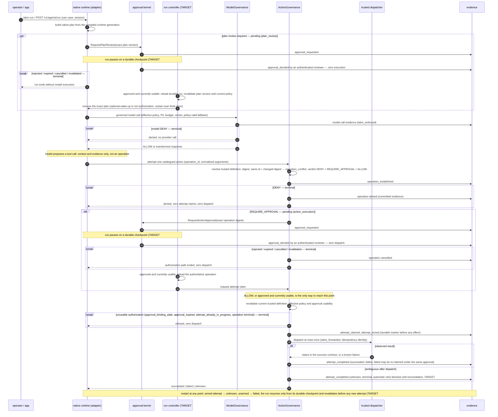
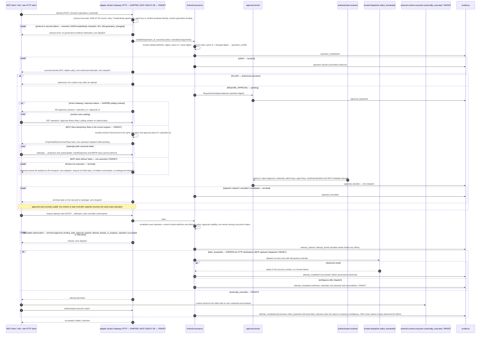

# Control-plane boundaries

**Status:** living architecture reference for [ADR-004](../contributor/adr/ADR-004-modular-control-plane-and-runtime-boundaries.md) ([#424](https://github.com/dativo-io/talon/issues/424)). The ADR holds the decisions; this page holds the diagrams, the ownership and disposition tables, and the shipped-versus-target status, and it changes as implementation lands. Every capability below is tagged **SHIPPED** or **TARGET**; a target is a direction with an owning issue, not product behavior.

Companion pages: [Talon object model](object-model.md) (canonical objects and lifecycles; not repeated here), [Action Gateway](action-gateway.md) (the shipped exact-action spine), [NVIDIA OpenShell composition](../integration/openshell.md) (the shipped DELEGATE example), [Talon as a control plane](../explanation/control-plane.md) (positioning), [LIMITATIONS.md](../../LIMITATIONS.md).

## 1. Positioning and doctrine

Talon is the **control layer for company AI use cases**: company policy compiled into use-case-specific, always-enforced controls, applied to model calls and consequential actions at boundaries Talon owns or that a trusted runtime delegates to it. Talon records signed, verifiable evidence of its decisions, of the effects it directly observed, and of enforcement it delegated or received as external assertions, each with explicit provenance (`talon_enforced`, `delegated_expected`, `external_asserted`, `client_asserted`; attempt outcomes `observed | not_dispatched | unknown`). A delegated decision is not an observed enforcement, and an unsigned imported fact is never `external_verified`. The stable object is the **AI use case** (`agent`); providers, models, MCP servers, frameworks, workflows and sandboxes are inputs or adapters.

```text
organization/company policy
        │
        ▼
AI use case / agent (agent.talon.yaml)
        │
        ▼
immutable compiled runtime generation            SHIPPED (#266/#267/#269/#427)
  ├── effective model / data / cost / reliability policy
  ├── trusted action catalog (explicit + MCP-discovered)
  ├── action authorization policy (DENY > REQUIRE_APPROVAL > ALLOW)
  └── identity / source configuration (keys, workload bindings, MCP sources)
```

Enforcement doctrine, one mechanism chosen per boundary, always the strongest honest one:

| Mechanism | Who prevents | Talon's claim in evidence | Shipped example | Target example |
|---|---|---|---|---|
| **INTERCEPT** | Talon owns the prevention boundary | Talon enforced the decision it made (`talon_enforced`, the default when no `enforcement` object is present) | HTTP model gateway `/v1/proxy`; Action Gateway `talon_forwarded` dispatch | governed MCP adapter once [#431](https://github.com/dativo-io/talon/issues/431) ships |
| **DELEGATE** | A trusted external runtime, at its pre-execution hook | Talon made and returned the decision; enforcement is expected of the runtime (`delegated_expected`) | OpenShell v0.1.3 supervisor middleware, `HTTP_REQUEST / PRE_CREDENTIALS` ([#482](https://github.com/dativo-io/talon/issues/482)) | — |
| **COMPILE** | The runtime's native primitive, from a Talon rule proven semantically equivalent and versioned | would state the compiled rule version | none; no OpenShell mapping is certified (the provider-allowlist → endpoint-allowlist candidate was rejected as non-equivalent) | none planned |
| **VERIFY** | Someone else; Talon reads back the fact | Talon imported or received a fact it did not enforce (`external_asserted` or `client_asserted`; never preventive) | `talon audit import-external --runtime openshell` (OCSF denials, `receipt.verified: false`) | authenticated `externally_executed` outcome reports and reconciliation ([#434](https://github.com/dativo-io/talon/issues/434), [#146](https://github.com/dativo-io/talon/issues/146)) |

Talon never labels a delegated or imported fact as enforced or verified by itself. `external_verified` exists in the evidence vocabulary but nothing writes it today.

## 2. Component ownership (diagram 1)

```text
┌─────────────────────────── outside the Talon process ───────────────────────────┐
│  SDK/app over OpenAI-compatible HTTP   MCP client (2026-07-28)   n8n / custom    │
│  native `talon run` operator            reviewer (CLI/API)       runtime client  │
│  NVIDIA OpenShell gateway + sandbox supervisors  ──(gRPC middleware, DELEGATE)─┐ │
└───────────────┬───────────────┬────────────────┬──────────────┬───────────────┼─┘
                ▼               ▼                ▼              ▼               ▼
┌───────────────────────────── one Talon binary / process ───────────────────────┐
│ ADAPTERS (thin; protocol, auth, DTOs, status mapping; no policy of their own)   │
│  HTTP model gateway   native runtime   MCP adapter   Action Gateway HTTP        │
│  CLI / API / reviewer surfaces   graph-events (context only)   OpenShell svc    │
│───────────────────────────────────▼────────────────────────────────────────────│
│ APPLICATION / DOMAIN SERVICES (one instantiation, one generation, one clock)    │
│  ModelGovernance        ActionGovernance        approval kernel (typed)         │
│  (governed model call)  (catalog → bind → verdict → operation/attempt)          │
│  native run controller  evidence writer + lifecycle verifier + projections      │
│───────────────────────────────────▼────────────────────────────────────────────│
│ REPOSITORIES AND CONTROLLED DISPATCHERS                                         │
│  SQLite stores (one local transaction per transition + evidence)                │
│  provider dispatchers   action dispatcher (HTTP today; MCP upstream: #431)      │
│  vault / payload cryptor   evidence sink   clock / id source                    │
└────────────────────────────────────────────────────────────────────────────────┘
dependency direction: adapters → application/domain → repositories/dispatchers
forbidden: adapter→adapter over localhost, internal HTTP/gRPC, parallel policy engines
```

### Responsibility and dependency table

| Component | Owns | Depends on | Must not depend on | Status |
|---|---|---|---|---|
| Runtime generation | one atomic snapshot per `agents_dir` scan: policies, compiled engines, catalog, workload bindings; last-known-good on rejected reload; `generation_changed` on mismatch | config loader, catalog compiler, MCP source discovery | adapters | SHIPPED (`internal/agentcatalog`) |
| ModelGovernance | provider/model eligibility, effective policy, PII classification and transformation, budgets, retries and policy-valid fallback, tool-schema filtering, model-call evidence | generation, provider dispatchers, evidence | action domain, MCP types | SHIPPED (one pre-dispatch decision shared by `/v1/proxy` and the delegated path) |
| ActionGovernance | definition resolution, normalization and digest, operation identity and conflict, verdict, approval binding, attempt claim/arm/complete, outcome provenance, lifecycle evidence | generation, repositories, action dispatcher, approver resolver, cryptor, evidence | HTTP, Cobra, MCP, UI | SHIPPED (`internal/action`, HTTP destinations only) |
| Approval kernel (typed) | durable request and decision, reviewer authorization, expiry and invalidation, concurrency, projection linkage, decision evidence | repositories, approver resolver, evidence | dispatch, plan semantics | SHIPPED for `action_execution` inside the action domain; TARGET as one kernel also serving `plan_review` ([#426](https://github.com/dativo-io/talon/issues/426), [#430](https://github.com/dativo-io/talon/issues/430)) |
| Native run controller | durable run and checkpoints, approval waits, claim-revalidate-dispatch, restart recovery | ModelGovernance, ActionGovernance, approval kernel | localhost adapters | TARGET ([#430](https://github.com/dativo-io/talon/issues/430)); today the native runner uses its own plan-review and tool-approval stores |
| Evidence | signed, tamper-evident lifecycle records (verifiable, not immutable; gap-checked, not proven complete), lifecycle verifier, exports and projections | repositories, signing key | adapters | SHIPPED (spec 1.12; `talon audit verify` runs the lifecycle verifier) |
| HTTP model gateway | OpenAI-compatible ingress, agent-key auth, provider-native errors | ModelGovernance | action domain | SHIPPED |
| Action Gateway HTTP | `/v1/action-operations*`, `/v1/approvals*`, status mapping, generation binding | ActionGovernance | — | SHIPPED (`talon_forwarded`) |
| MCP adapter | 2026-07-28 wire, header/body integrity, `server/discover`, `tools/list`, `tools/call`, upstream transport | TARGET: ActionGovernance | its own policy path | SHIPPED wire ([#447](https://github.com/dativo-io/talon/issues/447)); TARGET governance convergence ([#431](https://github.com/dativo-io/talon/issues/431)) |
| OpenShell middleware service | extension-protocol negotiation, manifest, workload JWT verification, request evaluation via ModelGovernance | ModelGovernance, workload verifier, evidence | OpenShell-specific policy | SHIPPED (request side) |
| Reviewer surfaces | CLI/API/minimal UI over one shared projection | approval kernel projections | direct store writes | TARGET ([#433](https://github.com/dativo-io/talon/issues/433)); today `talon approver` manages principals and decisions arrive over the Action Gateway API |
| External workflow client (n8n) | workflow waiting, branching, downstream execution and reporting | public Action Gateway API | Talon internals | TARGET ([#434](https://github.com/dativo-io/talon/issues/434)) |

## 3. Model governance versus action governance

Model governance is a per-request decision on model traffic:

```text
request → authenticated use case → effective model/data/cost policy
        → ALLOW | transform | DENY → provider attempt (or returned to the delegating runtime)
        → model-call evidence
```

Model governance may **restrict what actions a model can see** (tool-schema filtering, catalog discoverability). It never authorizes a side effect and never creates an action approval. A model-emitted tool proposal is context and evidence.

Action governance begins only at a concrete attempt:

```text
runtime/action adapter → trusted catalog definition → exact normalized payload
  → logical operation (operation_id + digest) → ActionGovernance verdict
  → DENY | REQUIRE_APPROVAL | ALLOW → authorized attempt (claim, arm) → controlled execution profile
  → known result | unknown
```

The chain that must never collapse:

```text
visible ≠ proposed ≠ attempted ≠ authorized ≠ dispatched ≠ succeeded
```

Discovery filtering is defense in depth; a direct or adversarial call that bypasses discovery still meets the catalog, the verdict and the attempt claim.

## 4. Canonical objects and identities

The object model is normative in [Talon object model](object-model.md). The identity hierarchy, and what each identifier is not:

```text
session_id    correlation, cost, understanding      ≠ operation, ≠ authority
run_id        Talon-native executable lifecycle     ≠ session
operation_id  one immutable intended business effect ≠ MCP JSON-RPC id, ≠ MCP Task id, ≠ trace id
approval_id   one human authorization decision      ≠ attempt
attempt_id    one execution/transport try           ≠ operation outcome
```

State axes stay separate:

| Axis | Vocabulary (SHIPPED unless noted) | Owner |
|---|---|---|
| Approval decision | `pending → approved \| rejected \| expired \| invalidated`; `cancelled` is TARGET vocabulary ([#426](https://github.com/dativo-io/talon/issues/426)). There is no `consumed` state. | approval kernel |
| Authorization usability | not a stored state: rechecked at every claim (approved, digest matches, policy digest current, unexpired for the first attempt); failures surface as `approval_expired`, `approval_binding_stale`, `approval_not_authorized` | ActionGovernance |
| Operation | `awaiting_approval \| authorized \| executing \| succeeded \| failed \| unknown \| cancelled \| denied` | ActionGovernance |
| Attempt | `started \| succeeded \| failed \| unknown` | ActionGovernance |
| Native run | run-contract vocabulary; waiting states never leak into session status | native runtime ([#430](https://github.com/dativo-io/talon/issues/430)) |
| Session | TARGET `open \| completed` with `managed_by` ([#401](https://github.com/dativo-io/talon/issues/401)); current store still carries the older vocabulary | session store |
| MCP Task | TARGET: protocol continuation and projection over the axes above, never a fourth authorization state ([#448](https://github.com/dativo-io/talon/issues/448)) | MCP adapter |

### Exact operation semantics (SHIPPED, [Action Gateway](action-gateway.md))

- `operation_id` is required and unique within tenant + use case; the digest binds tenant, use case, canonical action, canonicalized material arguments, the trusted definition digest (which carries source, upstream and connector identity) and the approval-policy digest.
- Same id + same digest → current state, no mutation. Same id + different digest → `409 operation_conflict`, nothing mutated. Material correction is a new operation.
- An approval authorizes the exact immutable subject digest, never an action name or a later payload. A reviewer approves or rejects and performs zero dispatch; the operation becomes `authorized` and waits for a runtime claim.
- Before any effect: revalidate the current trusted definition and policy, claim exactly one attempt (concurrent claims yield one winner, `attempt_already_in_progress` for the rest), write a durable arm marker, dispatch once, complete.
- `succeeded` and `unknown` are terminal; `failed` before the request left Talon may be claimed again under the same approval. `unknown` blocks automatic retry until an authorized reconciliation, which does not exist yet ([#146](https://github.com/dativo-io/talon/issues/146)).
- Crash recovery: an armed attempt is recovered as `unknown`, an unarmed one as `failed`. Talon claims at most one effect per operation, not universal exactly-once execution.

## 5. Approval kernel and reviewer boundary

Two typed subjects only: `plan_review` (native plan version) and `action_execution` (exact logical operation). The kernel owns the durable request and decision, authenticated reviewer identity authorized through policy groups, expiry and invalidation, decision concurrency, safe review projection linkage and mandatory evidence. It does not own policy evaluation, subject validity, workflow waiting, dispatch, arbitrary forms, escalation, quorum, MCP input or generic tasks. It may signal continuation eligibility; it never dispatches or resumes.

| Aspect | SHIPPED today | TARGET |
|---|---|---|
| `action_execution` | approval inside `internal/action`; local tenant-scoped approver principals with revocable credentials; decision over `POST /v1/approvals/{id}/decisions`; expiry and definition-change invalidation; decision performs no dispatch | reviewer CLI/API/UI over one shared projection ([#433](https://github.com/dativo-io/talon/issues/433)) |
| `plan_review` | legacy plan store with its own states and admin-key decisions; approved plans are auto-dispatched by a poller in `talon serve` | typed subject of the shared kernel; decision never starts the run, the run controller resumes ([#430](https://github.com/dativo-io/talon/issues/430), [#426](https://github.com/dativo-io/talon/issues/426)) |
| native tool approval | in-memory store, admin-key decisions, approve-then-run | replaced by canonical `action_execution` ([#430](https://github.com/dativo-io/talon/issues/430)) |
| review projection | `talon/review-projection/v1` safe projection bound in the definition digest | unchanged |

Reviewer rules: `approve` or `reject` only, bounded comment, required rejection reason, no transformation of the subject, and the committed decision is immutable history. Operator authority, agent keys and workload identities never confer approval authority on the canonical spine.

## 6. Execution profiles

| | `talon_forwarded` — SHIPPED | `externally_executed` — TARGET ([#434](https://github.com/dativo-io/talon/issues/434), [#429](https://github.com/dativo-io/talon/issues/429)) |
|---|---|---|
| Who dispatches | Talon, through a trusted dispatcher (HTTP destinations today; MCP upstream with [#431](https://github.com/dativo-io/talon/issues/431)) | the external runtime, with its own credential and transport |
| Talon owns | authorization, attempt claim, idempotency identity, transport result, evidence | operation identity, exact binding, approval, attempt permission, authenticated report validation, reconciliation |
| Runtime owns | nothing on the dispatch path | waiting, polling, retries, downstream execution, outcome reporting |
| Outcome provenance | `observed` when the outcome was actually observed; `not_dispatched`; `unknown` after an ambiguous post-dispatch failure | `client_asserted` until reconciled by an explicitly supported mechanism; Talon never claims to have observed the effect |
| Retry | `failed` may be retried under the same approval; `unknown` blocks | runtime may claim a new attempt only through Talon's explicit retry authorization; `unknown` blocks |

The profile is part of the trusted definition and cannot be chosen by the calling runtime. MCP-discovered definitions are catalogued as `talon_forwarded` but return `execution_unsupported` until #431 adds the upstream dispatcher.

## 7. Waiting and continuation ownership

Invariant on every surface:

```text
approval decision committed → optional signal → owning runtime/controller resumes from durable state
→ exact operation and current controls revalidated → attempt claimed → dispatch
```

| Environment | Who waits | Who resumes | Transport held open? | Status |
|---|---|---|---|---|
| Native Talon | durable run checkpoint in SQLite | native run controller: reloads truth, revalidates, claims attempt, dispatches; in-process wake-up is an optimization, scan/restart recovery is sufficient | no | TARGET ([#430](https://github.com/dativo-io/talon/issues/430)); current legacy paths block on an in-memory channel (tool approval) or poll approved plans (Plan Review) |
| External workflow (n8n, custom) | the runtime, polling stable operation and approval resources with `Retry-After` | the runtime continues the same exact operation and claims an attempt; notifications may lower latency but never carry authorization truth | no | SHIPPED polling contract on the Action Gateway; TARGET reference adapter ([#434](https://github.com/dativo-io/talon/issues/434)) |
| MCP, client advertises Tasks in the current request | durable MCP Task bound to the same operation and approval | the same controller rules; `tasks/get` polls canonical state and creates no authorization; `tasks/update` cannot submit a human approval | no | TARGET ([#448](https://github.com/dativo-io/talon/issues/448)); today `server/discover` advertises no Tasks and an upstream `resultType: task` is rejected |
| MCP, client without Tasks | nobody: honest non-execution, zero dispatch, no later background dispatch | — | no | TARGET behavior; today MCP calls do not reach ActionGovernance at all |
| MRTR (`input_required`, `requestState`, `inputResponses`) | protocol input continuation only | — | no | SHIPPED pass-through on `/mcp/proxy`; never a Talon human approval |

## 8. Native sequence (diagram 2)

`break` frames are terminal: nothing below a `break` executes on that path. Steps marked `TARGET #430` describe the durable run controller design; the shipped native runner still uses the legacy plan store with its auto-dispatch poller and the in-memory tool-approval store, and those legacy paths are not what this diagram promises. Everything else is current behavior of the shared domains.



## 9. External and MCP sequence (diagram 3)

`break` frames are terminal. SHIPPED: the Action Gateway path with the external-runtime polling contract and `talon_forwarded` HTTP dispatch. TARGET: MCP reaching ActionGovernance at all ([#431](https://github.com/dativo-io/talon/issues/431)), Tasks continuation ([#448](https://github.com/dativo-io/talon/issues/448)), `externally_executed` ([#434](https://github.com/dativo-io/talon/issues/434)), reconciliation of `unknown` ([#146](https://github.com/dativo-io/talon/issues/146)). A Task is a projection over the operation and approval, never the operation.



## 10. MCP 2026-07-28 boundary

| Rule | Status |
|---|---|
| Protocol 2026-07-28 only; no negotiation or fallback; every request self-describing through per-request `_meta` and `MCP-Protocol-Version` | SHIPPED |
| No `initialize` / `notifications/initialized` exchange (rejected with 404 / -32601); no `Mcp-Session-Id` (ignored, never minted); GET/DELETE 405 | SHIPPED |
| `Mcp-Method`, `Mcp-Name`, `Mcp-Param-*` must agree with the body; mismatch is `-32020`, a protocol and security failure before governance, with no governance evidence written | SHIPPED |
| `server/discover` advertises only implemented capabilities (today `tools`, no extensions) | SHIPPED |
| `tools/list` is a deterministic projection of one captured trusted catalog generation | TARGET ([#431](https://github.com/dativo-io/talon/issues/431)); today `/mcp` lists the in-process registry and `/mcp/proxy` lists a TTL-bound capture of the upstream |
| `tools/call` re-enters ActionGovernance on every call; visibility grants nothing | TARGET ([#431](https://github.com/dativo-io/talon/issues/431)); today both routes use the OPA tool-access path and `/mcp` runs tools in-process |
| one canonical `POST /mcp`; the server/proxy split and the `native | proxy | hybrid` modes are removed | TARGET ([#431](https://github.com/dativo-io/talon/issues/431)) |
| synthetic execution identities (`mcp-client`, `mcp-proxy`) replaced by the authenticated use case | TARGET ([#431](https://github.com/dativo-io/talon/issues/431)) |
| Tasks as adapter continuation; `resultType: task` upstream is deferred state, not success | TARGET ([#448](https://github.com/dativo-io/talon/issues/448)); today rejected |
| MRTR passes through as non-authorizing input | SHIPPED on `/mcp/proxy` |
| Talon governance extension `io.dativo.talon/governance`: one registry of stable codes shared with the Action Gateway, retryability, committed evidence references in `error.data` / result `_meta`, advertised in `server/discover`; protocol errors carry none | SHIPPED ([#372](https://github.com/dativo-io/talon/issues/372), [reference](mcp-governance-extension.md)); operation/approval/task identifiers in the extension arrive with [#431](https://github.com/dativo-io/talon/issues/431)/[#448](https://github.com/dativo-io/talon/issues/448) |

Talon `session_id` is application correlation and is never derived from any MCP transport concept.

## 11. OpenShell: the DELEGATE example (SHIPPED, request side)

Reference composition: NVIDIA/OpenShell v0.1.3, docker driver, Talon registered as supervisor middleware with one binding `HTTP_REQUEST / PRE_CREDENTIALS`, extension protocol 1.0 negotiated reciprocally, gateway-signed EdDSA workload JWT (`spiffe://openshell/sandbox/<id>`) bound to one use case through `agent.workload_identity.bindings`, Talon over TLS from an operator CA, OpenShell injecting the provider credential only after Talon answers. Live proof against the released runtime: gateway starts with Talon; ALLOW reaches the provider once with OpenShell's credential; Talon's PII transformation reaches the provider; DENY yields zero provider calls; a valid but unbound sandbox identity is denied; Talon unavailable → OpenShell `middleware_failed` (fail closed); Talon restart reconnects; the provider credential never enters Talon; delegated evidence verifies offline. Details: [NVIDIA OpenShell composition](../integration/openshell.md).

```text
sandbox agent → OpenShell network admission → Talon PRE_CREDENTIALS middleware
             → Talon ALLOW / transform / DENY → OpenShell credential injection → provider
```

| Concern | Talon | OpenShell |
|---|---|---|
| company and use-case model/action policy, exact business authorization, signed evidence | owner | — |
| process, filesystem, syscall and network containment; sandbox lifecycle; provider credential injection; runtime-local enforcement | — | owner |

Evidence semantics on this path are literal: `mechanism: delegate`, `boundary: external_runtime`, `decision_authority: talon`, `provenance: delegated_expected`, `decision_returned_via: openshell_middleware`, `upstream_auth_mode: external_runtime`. Talon proves it made and returned its decision; it does not claim it observed OpenShell enforcing it. Imported OCSF containment events are `mechanism: verify`, `provenance: external_asserted`, `receipt.verified: false`, `workload_identity.status: asserted`, never `external_verified`.

Not implemented: OpenShell v0.1.3 offers `HTTP_RESPONSE / PRE_RETURN` and WebSocket middleware; Talon does not advertise or implement either. No Talon → OpenShell COMPILE mapping is supported because no rule mapping has been shown semantically equivalent. OpenShell is an example; core domains carry no OpenShell dependency.

## 12. Identity classes

| Class | Established by | Grants | Never grants |
|---|---|---|---|
| AI use case / agent | vault-bound agent key → one agent → derived tenant | gateway traffic, tenant-scoped reads, Action Gateway runtime routes | approval authority, operator authority |
| Verified workload / runtime principal | gateway-signed JWT verified against configured issuer, audience and keys, bound through `agent.workload_identity.bindings` ([#457](https://github.com/dativo-io/talon/issues/457) owns breadth) | the bound use case on the delegated path | approval authority; a verified identity without a binding is `workload_identity_unbound` |
| Application / session attribution | `X-Talon-Session-ID`, `X-Talon-Client`, `managed_by`, MCP `clientInfo` | grouping and display | authentication, authority, policy input |
| Human reviewer principal | local approver credential (`talon approver add`), tenant-scoped, policy-authorized groups; OIDC is a later resolver | decisions on `action_execution` approvals | operator authority, runtime identity |
| Platform operator | `TALON_ADMIN_KEY` | secrets, policies, fleet, dashboards, legacy plan and tool approvals (current, converging under [#430](https://github.com/dativo-io/talon/issues/430)) | Action Gateway approvals (refused), impersonating an agent |
| Protocol / request / task correlation | JSON-RPC id, MCP Task id, `requestState`, trace ids | continuation and correlation | operation identity, bearer authorization |

Talon is not an identity provider, certificate authority, token issuer or trust mesh.

## 13. Always-enforced posture

Live traffic has no global non-enforcing posture; the removal shipped in [#442](https://github.com/dativo-io/talon/issues/442) and the legacy keys are rejected at load. Synthetic, non-authorizing surfaces that exist: `talon run --dry-run`, `POST /v1/policies/evaluate`, `talon actions list|show|validate`, `talon validate`, `talon audit import-external --dry-run`. A side-effect-free policy-impact preview is TARGET ([#459](https://github.com/dativo-io/talon/issues/459)). None of them weakens a live hard control or creates reusable authorization. Historical evidence written with older posture fields stays readable.

## 14. Provenance vocabulary

| Value | Meaning | Written today |
|---|---|---|
| `talon_enforced` (implicit when no `enforcement` object) | Talon owned the boundary and enforced its own decision | yes, by omission on INTERCEPT paths |
| `delegated_expected` | Talon decided; a trusted runtime is expected to enforce | yes (OpenShell) |
| `external_asserted` | imported fact enforced elsewhere, unverified | yes (OCSF import) |
| `external_verified` | imported fact with a verified receipt | no writer |
| `client_asserted` | outcome reported by an external runtime | defined; written when `externally_executed` ships ([#434](https://github.com/dativo-io/talon/issues/434)) |
| result `observed` / `not_dispatched` / `unknown` | Action Gateway attempt outcome provenance | yes |
| result `reconciled` | outcome established by authorized reconciliation | defined; no writer ([#146](https://github.com/dativo-io/talon/issues/146)) |

## 15. Current-surface disposition

| Current surface | Today | Target disposition | Owner |
|---|---|---|---|
| HTTP LLM gateway (`/v1/proxy`) | SHIPPED, INTERCEPT, shared pre-dispatch decision | RETAIN as adapter over ModelGovernance | [#432](https://github.com/dativo-io/talon/issues/432) parity |
| Native model execution (`talon run`, `/v1/agents/run`) | SHIPPED, in-process | RETAIN; calls ModelGovernance directly | [#430](https://github.com/dativo-io/talon/issues/430) |
| Native Plan Review | SHIPPED legacy: plan store, admin-key decision, approve → auto-dispatch poller | MIGRATE to typed `plan_review` over the approval kernel; controller resumes, decision never dispatches | [#430](https://github.com/dativo-io/talon/issues/430), [#426](https://github.com/dativo-io/talon/issues/426) |
| Native tool approval | SHIPPED legacy: in-memory store, admin-key decision, approve → run | REPLACE with canonical `action_execution` | [#430](https://github.com/dativo-io/talon/issues/430) |
| Process-local customer business tools (`Tool.Execute` registry) | SHIPPED as implementation detail of `/mcp` and the native runner | REMOVE as target product dependency; business actions execute in upstream MCP servers or external runtimes | [#431](https://github.com/dativo-io/talon/issues/431) |
| MCP server/proxy split (`/mcp`, `/mcp/proxy`) | SHIPPED: one 2026-07-28 wire, two governance paths, synthetic fallback identities | MIGRATE to one governed `POST /mcp` over ActionGovernance | [#431](https://github.com/dativo-io/talon/issues/431) |
| MCP initialize/session lifecycle | REMOVED: rejected on the wire (not supported) | none; no previous-protocol compatibility | [#447](https://github.com/dativo-io/talon/issues/447) closed |
| MCP approval continuation | none (Tasks not advertised; approval-required calls cannot occur before #431) | Tasks extension over canonical state; MRTR for non-authorizing input only; honest non-execution without Tasks | [#448](https://github.com/dativo-io/talon/issues/448), [#372](https://github.com/dativo-io/talon/issues/372) |
| Graph event ingestion (`/v1/graph/events`) | SHIPPED: allow/deny decisions from the OPA path | RETAIN as context and telemetry; never enforcement authority or approval channel | [#431](https://github.com/dativo-io/talon/issues/431) scope note, ADR-003 amended |
| n8n / custom workflows | none shipped (hidden wizard pack only) | external client over the public Action Gateway; owns waiting and external execution | [#434](https://github.com/dativo-io/talon/issues/434) |
| Session store | SHIPPED with the older status vocabulary | RETAIN as lightweight correlation and summary: `open \| completed`, `managed_by` | [#401](https://github.com/dativo-io/talon/issues/401) |
| Separate approval stores and channels (plans, tool approvals, action approvals) | SHIPPED: three mechanisms | REPLACE with one typed kernel and store | [#426](https://github.com/dativo-io/talon/issues/426), [#433](https://github.com/dativo-io/talon/issues/433) |
| Global `shadow` / `log_only` / `passthrough` posture | REMOVED ([#442](https://github.com/dativo-io/talon/issues/442)); historical evidence readable | none | closed |
| Internal HTTP/gRPC between Talon modules | none; the only gRPC is the OpenShell middleware served to an external runtime | NOT INTRODUCED in v1 | ADR-004 |
| Action Gateway (`/v1/action-operations*`, `/v1/approvals*`) | SHIPPED, `talon_forwarded`, generation-bound | RETAIN as the public authorization adapter; add `externally_executed` and reconciliation | [#429](https://github.com/dativo-io/talon/issues/429), [#434](https://github.com/dativo-io/talon/issues/434), [#146](https://github.com/dativo-io/talon/issues/146) |
| OpenShell middleware (gRPC, `PRE_CREDENTIALS`) | SHIPPED, DELEGATE, request side | RETAIN; response side and WebSocket are open design, not committed | [#482](https://github.com/dativo-io/talon/issues/482) |

## 16. Shipped-versus-target migration notes

1. **Action spine first.** The action domain, Action Gateway, approver principals and lifecycle evidence are the canonical implementation. New adapters (#431 MCP, #430 native, #434 external) call them; they do not fork them.
2. **MCP convergence (#431)** replaces two governance paths with one adapter, removes synthetic identities and in-process business tools, adds the MCP upstream dispatcher so MCP-sourced definitions stop returning `execution_unsupported`, and makes `tools/list` a generation projection. #372 shipped the extension vocabulary and evidence references that #431 and #448 reuse.
3. **Native convergence (#430)** moves Plan Review and tool approval onto the typed kernel and a durable run controller. Until then the legacy approve-then-run behavior is current product behavior and is documented as such, not as target.
4. **External profile (#434)** adds `externally_executed` and `client_asserted` outcomes without new domain authorities. Reconciliation of `unknown` (#146) lands with it or before.
5. **Sessions (#401)** simplify to `open | completed` plus `managed_by`; docs describing that vocabulary are target until the store changes.
6. **Parity gate (#435)** proves from public interfaces that native, MCP and n8n consume the same generation, catalog, approval, operation and evidence model.

## 17. Hard invariants and their owners

| Invariant | Implementation owner | Executable proof |
|---|---|---|
| one compiled generation, atomic swap, last-known-good; generation-bound action resolution | [#425](https://github.com/dativo-io/talon/issues/425) compiler, [#427](https://github.com/dativo-io/talon/issues/427) catalog (closed) | `agentcatalog` reload tests, `generation_changed` tests; [#435](https://github.com/dativo-io/talon/issues/435) |
| same id + same digest reuse; changed digest → `operation_conflict`; one attempt per claim; `unknown` blocks retry; crash recovery | [#426](https://github.com/dativo-io/talon/issues/426), [#429](https://github.com/dativo-io/talon/issues/429) | `internal/action` contract tests (`TestOutcome_TruthTable`, `TestConcurrentClaims_OneEffect`, `TestRecoverInterrupted_CrashPoints`); #435 |
| approval decision performs zero dispatch; no `consumed`; usability rechecked at claim | [#426](https://github.com/dativo-io/talon/issues/426), [#429](https://github.com/dativo-io/talon/issues/429) | `TestApprovalLifecycle_ExactlyOneEffect`, `TestDefinitionChange_InvalidatesAuthorization`; #435 |
| only authenticated, policy-authorized reviewers decide; operator and workload identities refused | [#428](https://github.com/dativo-io/talon/issues/428) | Action Gateway auth tests; #435 identity matrix |
| atomic state + evidence transitions, gap-free lifecycle, verifier | [#146](https://github.com/dativo-io/talon/issues/146) | `verify_test.go`, `talon audit verify`; #435 |
| DENY → zero provider or destination dispatch on every surface | [#432](https://github.com/dativo-io/talon/issues/432), [#431](https://github.com/dativo-io/talon/issues/431) | `TestDeny_ZeroDispatch`, OpenShell live case C, gateway tests; #435 |
| MCP 2026-07-28 only; header/body integrity before governance; no session or handshake | [#447](https://github.com/dativo-io/talon/issues/447) (closed) | `internal/mcp/wire` tests, `legacy_guard_test.go`; #435 |
| `tools/call` re-authorized through ActionGovernance; no synthetic identities; no in-process business tools | [#431](https://github.com/dativo-io/talon/issues/431) | #431 tests; #435 |
| Tasks are projection; MRTR and `tasks/update` never approve; non-Tasks client gets zero dispatch | [#448](https://github.com/dativo-io/talon/issues/448), [#372](https://github.com/dativo-io/talon/issues/372) | #448 tests; #435 |
| native run controller resumes from durable state; wake-up optional; restart recovery | [#430](https://github.com/dativo-io/talon/issues/430) | #430 tests; #435 |
| `externally_executed` outcomes are `client_asserted`; missing reports never become observed failures | [#434](https://github.com/dativo-io/talon/issues/434) | #434 tests; #435 |
| reviewer surfaces share one projection; no raw payload by default | [#433](https://github.com/dativo-io/talon/issues/433) | #433 tests; #435 |
| verified workload identity binds through configuration only; attribution never authenticates | [#457](https://github.com/dativo-io/talon/issues/457), [#482](https://github.com/dativo-io/talon/issues/482) | `internal/workload` tests, OpenShell live case D |
| delegated decisions are `delegated_expected`; imported facts `external_asserted`; nothing claims `external_verified` | [#482](https://github.com/dativo-io/talon/issues/482), [#146](https://github.com/dativo-io/talon/issues/146) | OpenShell fixture and live evidence assertions |
| no global non-enforcing posture; synthetic surfaces non-authorizing | [#442](https://github.com/dativo-io/talon/issues/442) (closed), [#459](https://github.com/dativo-io/talon/issues/459) | `tests/posture_vocabulary_test.go`, `cmd/posture_removed_test.go` |
| sessions are correlation only | [#401](https://github.com/dativo-io/talon/issues/401) | #401 tests |
| ADR and reference cross-linked and indexed; docs make no stale target claims | this page | `tests/architecture_docs_test.go` |

## 18. What Talon cannot control

Talon controls only effects at supported boundaries: model traffic through its gateway or a delegating runtime, and catalogued actions attempted through the Action Gateway (and, after #431, the governed MCP adapter). It cannot prevent local shell commands, direct filesystem edits, direct browser automation, direct business API calls, an alternate provider path, or local tool execution when those effects bypass every Talon-controlled or delegated boundary. OpenShell can contain its own sandbox, which narrows those paths for that sandbox only; it does not make Talon a universal agent-control product, and no diagram above implies otherwise. Attribution metadata is not authentication; `delegated_expected` is not observation; `external_asserted` is not verification; signed evidence is tamper-evident, not immutable.

## 19. Issue index

Closed: [#427](https://github.com/dativo-io/talon/issues/427) catalog, [#442](https://github.com/dativo-io/talon/issues/442) posture, [#447](https://github.com/dativo-io/talon/issues/447) MCP wire. Open owners: [#425](https://github.com/dativo-io/talon/issues/425) policy compiler, [#426](https://github.com/dativo-io/talon/issues/426) durable state, [#428](https://github.com/dativo-io/talon/issues/428) approver identity, [#429](https://github.com/dativo-io/talon/issues/429) public Action Gateway, [#146](https://github.com/dativo-io/talon/issues/146) lifecycle evidence, [#372](https://github.com/dativo-io/talon/issues/372) MCP extension, [#430](https://github.com/dativo-io/talon/issues/430) native convergence, [#431](https://github.com/dativo-io/talon/issues/431) MCP convergence, [#433](https://github.com/dativo-io/talon/issues/433) reviewer surfaces, [#434](https://github.com/dativo-io/talon/issues/434) external runtime, [#435](https://github.com/dativo-io/talon/issues/435) parity gate, [#448](https://github.com/dativo-io/talon/issues/448) MCP Tasks, [#457](https://github.com/dativo-io/talon/issues/457) workload federation, [#458](https://github.com/dativo-io/talon/issues/458) exact-action proof, [#482](https://github.com/dativo-io/talon/issues/482) OpenShell composition, [#401](https://github.com/dativo-io/talon/issues/401) sessions.
